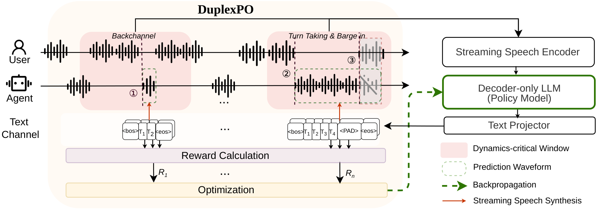

# DuplexPO

**Decoupling Conversational Dynamics in Full-Duplex Spoken Models through Reinforcement Learning**
(NeurIPS 2026)

[](https://arxiv.org/abs/2607.07148)
[](https://liyuxin44.github.io/DuplexPO/)
[](https://pypi.org/project/duplexpo/)
[](https://github.com/LiYuxin44/DuplexPO_official/actions/workflows/ci.yml)
[](https://github.com/LiYuxin44/DuplexPO_official/blob/main/LICENSE)

[Paper](https://arxiv.org/abs/2607.07148) · [Demo page](https://liyuxin44.github.io/DuplexPO/) · [Algorithm notes](https://github.com/LiYuxin44/DuplexPO_official/blob/main/docs/ALGORITHM.md) · [Adapter guide](https://github.com/LiYuxin44/DuplexPO_official/blob/main/docs/ADAPTER_GUIDE.md)

DuplexPO teaches a full-duplex spoken dialogue model *when* to speak without
changing *what* it says: RL over short dynamics-critical windows of real human
conversation, scored by the Factorized Conversational Dynamics Reward (FCDR),
with a KL anchor to the instruction-tuned SFT model. The model's turn-taking,
backchanneling, and barge-in handling improve while QA, instruction-following,
and reasoning benchmarks are maintained.

<p align="center">
  
</p>

This repository is the reference implementation of the data construction,
reward, and event-level GRPO objective from the paper. The package is
framework-neutral and covers:

1. constructing dynamics-critical events (windows) from aligned full-duplex
   dialogue (Fisher-style word alignments, Seamless-style utterances, or any
   source with the same shape);
2. scoring arbitrary policy rollouts with the FCDR reward and turning them into
   event-grouped GRPO training records (advantages, loss mask, KL reference).

It runs on the Python standard library alone (PyTorch is needed only for the
optional `torch_batch_loss` helper) and works with any speech-token vocabulary,
trainer, or runtime.

## What this repository provides

- transcript canonicalization adapters and the Fisher / Seamless construction
  profiles, with the exact thresholds used for the paper;
- dynamics-critical window construction and deterministic selection;
- the FCDR reward with two token decoders;
- event-grouped advantages and the reference GRPO loss (`torch_batch_loss`);
- a machine-readable recipe (`recipes/paper_v1.json`) with content hashes;
- conformance checks and hashed example outputs for validating outside adapters.

The paper checkpoint was trained with the NeMo Toolkit on top of the
Nemotron-VoiceChat recipe (Qwen2.5-7B-Instruct backbone, Parakeet encoder,
CosyVoice2 codec) on licensed Fisher / Seamless Interaction data. Any policy
trained in that stack or another one plugs in through `Rollout` /
`TraceDecoder`; `docs/ADAPTER_GUIDE.md` walks through the integration.

## Stable boundary

```text
canonical Conversation
        -> transcript construction
selected Window (one GRPO group per conversational event)
        -> any policy/runtime
Rollout -> pluggable TraceDecoder -> ActionTrace
        -> factorized conversational-dynamics reward
GRPORecord {window, group_id, reward, advantage, action_ids, loss_mask, ref_logprobs}
        -> any trainer backend
```

The schemas under `src/duplexpo_portable/schemas/` are the public compatibility
boundary. Framework adapters are deliberately thin and disposable.

## Install

```bash
pip install duplexpo
```

This installs the `duplexpo_portable` package and the `duplexpo` command.
Python 3.9+ and no third-party dependencies. For the development version:

```bash
git clone https://github.com/LiYuxin44/DuplexPO_official.git
cd DuplexPO_official
pip install -e .
```

## Quick start

Run the complete synthetic example (window construction, FCDR scoring, GRPO
records, and conformance checks) from a clone of this repository:

```bash
duplexpo construct \
  --profile fisher \
  --input examples/conversations.jsonl \
  --output /tmp/duplexpo-windows.jsonl \
  --audit-output /tmp/duplexpo-audit.jsonl \
  --segments-output /tmp/duplexpo-segments.jsonl

duplexpo prepare \
  --windows /tmp/duplexpo-windows.jsonl \
  --rollouts examples/rollouts.jsonl \
  --output /tmp/duplexpo-grpo.jsonl

duplexpo conformance \
  --windows /tmp/duplexpo-windows.jsonl \
  --rollouts examples/rollouts.jsonl \
  --records /tmp/duplexpo-grpo.jsonl
```

Without installing, `PYTHONPATH=src python -m duplexpo_portable.cli` is a
drop-in replacement for `duplexpo`. The window, audit, and GRPO-record outputs
match `examples/expected/` byte for byte (`examples/README.md`).

`--segments-output` holds the user/agent segments the reward is defined on;
render the teacher-forced prefix of each window from it (see
`docs/ADAPTER_GUIDE.md`).

For token-based models, emit one `action_ids` entry per sampled frame instead
of `trace` and add `--bos-ids 1 --eos-id 2 --pad-id 0` (explicit speech BOS) or
`--silence-ids 0 --eos-id 2` (no BOS: speech starts at the first non-silence
token). For a different action language, implement one method:

```python
class MyTraceDecoder:
    def decode(self, rollout, window):
        return ActionTrace(speech=(SpeechInterval(start_s=..., end_s=...),))
```

Then call `prepare_grpo_update(...)`. The policy and trainer never need to
share internal classes with this package.

## Paper recipe represented here

- 80 ms frame grid;
- 1.0 s training lead and 2.0 s post-event buffer;
- at most three eligible full turns and one backchannel per conversation;
- four rollouts per selected event (the caller controls generation count);
- per-event population mean/std reward normalization, epsilon `1e-8`, clipped
  to `[-5, 5]`;
- sampled-token-only policy gradient;
- Schulman KL estimator against frozen SFT reference logprobs with beta `0.2`
  (behavior logprobs only by explicit opt-in);
- the reported FCDR reward (onset Gaussian, backchannel plateau, 0.75 no-stop
  scale);
- training setup (full-parameter, 64 x A800, lr 1e-5, conversation-level
  batches) recorded in `recipes/paper_v1.json` under `training`.

See `docs/ALGORITHM.md` for equations and fidelity notes.

## Repository map

- `src/duplexpo_portable/construction.py`: Fisher/Seamless construction profiles,
  leak-safe splitting, quality audit, and balanced mixing.
- `src/duplexpo_portable/backchannel_lexicon.py`: paper-time English 1--5 gram taxonomy.
- `src/duplexpo_portable/windows.py`: critical-window construction and selection.
- `src/duplexpo_portable/rewards.py`: token-neutral FCDR and two token decoders.
- `src/duplexpo_portable/grpo.py`: grouped advantages and reference loss.
- `src/duplexpo_portable/recipes/paper_v1.json`: wheel-bundled, machine-readable recipe.
- `src/duplexpo_portable/conformance.py`: executable checks for outside adapters.
- `src/duplexpo_portable/adapters/`: generic, TRL, verl, and NeMo RL bridges.
- `src/duplexpo_portable/schemas/`: JSON Schema compatibility contracts.
- `examples/`: synthetic inputs plus hashed, byte-for-byte conformance outputs.
- `tests/`: dependency-free unit and end-to-end tests
  (`PYTHONPATH=src python -m unittest discover -s tests`).
- `docs/`: `ALGORITHM.md` (windows, reward, loss, training setup),
  `DATA_CONSTRUCTION.md`, `PROTOCOL.md`, `ADAPTER_GUIDE.md`.

## Data

Dataset adapters (`adapters/datasets.py`) canonicalize licensed Fisher and
Seamless Interaction transcripts into `Conversation` records. Audio paths or
tensors travel through `metadata`; the construction and GRPO protocol operate on
timing metadata only, so the pipeline runs on transcripts alone.

## Citation

```bibtex
@article{li2026duplexpo,
  title   = {Decoupling Conversational Dynamics in Full-Duplex Spoken Models through Reinforcement Learning},
  author  = {Li, Yuxin and Wu, Donghang and Lin, Guan-Ting and Lee, Hung-yi and Qin, Chengwei and Chen, Zhehuai and Chen, Chen},
  journal = {arXiv preprint arXiv:2607.07148},
  year    = {2026}
}
```

## License

The code in this repository is released under the [MIT License](LICENSE).
Datasets, model checkpoints, and third-party model code retain their original
licenses.
